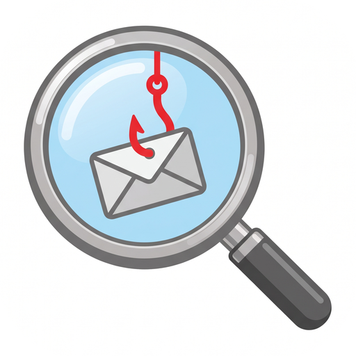
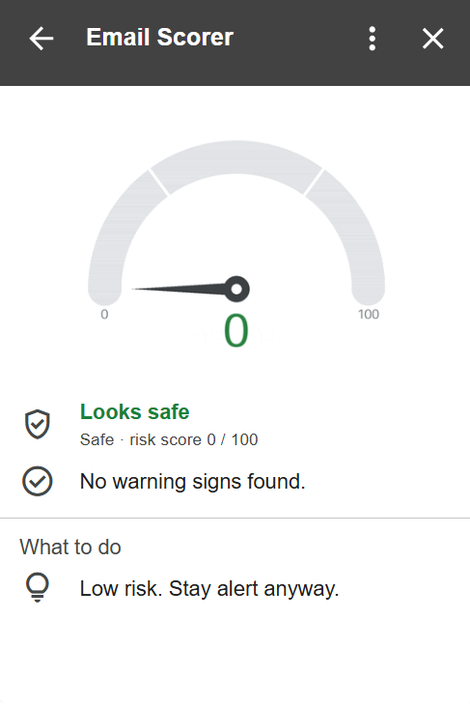
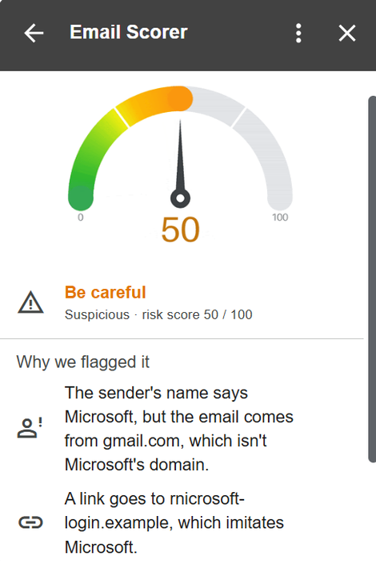
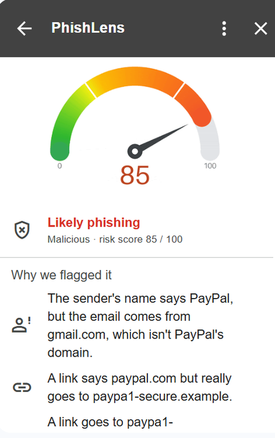

<p align="center">
  
</p>

<h1 align="center">PhishLens</h1>

<p align="center"><b>See what every email is really hiding.</b></p>

A Gmail add-on that checks every email you open and tells you, in plain words, whether it looks
**Safe**, **Suspicious** or **Malicious**: a risk score from 0 to 100 and the exact reasons behind it.

| Safe | Suspicious | Malicious |
|:---:|:---:|:---:|
|  |  |  |
| A real email:<br>no warning signs | Fake "Microsoft" sender<br>with an `rnicrosoft` link | Fake "PayPal" email<br>with disguised links |

<br>
<br>

## Strong points

- **Explains every score:** plain-language reasons, no black box.
- **Catches hidden tricks:** look-alike letters, fake link text, disguised file names.
- **Secure by design:** only this add-on can call the server, and nothing is stored.
- **Tested against bypasses:** 98 automated tests plus real phishing-style emails in Gmail.
- **Easy to read:** animated risk gauge, icons and clear advice.
- **Fast and cheap:** scores in milliseconds on Cloud Run, which scales to zero when idle.

<br>
<br>

## How it works

```
 GMAIL      You open an email
   │
   ▼
 ADD-ON     Apps Script (addon/Code.js)
   │        Collects: sender, Reply-To, auth header,
   │                  HTML body, attachment names
   │
   │        HTTPS + Google ID token
   ▼
 BACKEND    Python + FastAPI on Cloud Run (backend/)
   │        1. Verify token    only this add-on may call it
   │        2. Run checks      auth · identity · links · attachments
   │        3. Score           group caps → total → verdict → top 3 reasons
   │
   │        JSON: score, verdict, reasons
   ▼
 CARD       Animated gauge · verdict · why we flagged it · what to do
```

The core idea is a **signal**: one small, explainable finding.

```
Signal(group="links", points=25, reason="A link says paypal.com but really goes to paypa1-secure.example.")
```

Each check returns zero or more signals. Scoring turns them into one verdict:

```
 signals  →  add points per group  →  cap each group  →  total (max 100)  →  verdict

 A disguised attachment skips the sum and forces the score to 100.
```

| Score | Verdict |
|:---:|---|
| 0–29 | 🟢 Safe |
| 30–69 | 🟠 Suspicious |
| 70–100 | 🔴 Malicious |

Group caps stop one noisy area from deciding everything alone: ten bad links can't outweigh
everything else, and a clean sender can't hide a dangerous attachment.

<br>
<br>

## What it checks

### 1. Authentication: is the sender who it claims to be? (cap 35)

Read from the `Authentication-Results` header that **Gmail itself** adds, never from one the sender
wrote (we tested that Gmail strips forged copies sent through Gmail).

| Check | Points |
|---|:---:|
| SPF fail: the sending server isn't allowed to send for this domain | +15 |
| SPF soft fail | +5 |
| DKIM broken or missing: no valid digital signature | +10 |
| DMARC fail: the domain owner says this email isn't theirs | +20 |

<br>

### 2. Identity: is the sender pretending to be a brand? (cap 50)

Compared against 50 of the most impersonated brands, including major Israeli banks.

| Check | Example | Points |
|---|---|:---:|
| Lookalike domain | `paypa1.com`, `micros0ft-support.com`, `rnicrosoft.com`, `аpple.com` (Cyrillic), `amazom.com` | +30 |
| Brand name on a non-brand address | `"PayPal Security" <x123@gmail.com>` | +25 |
| Replies go to a different domain | From `ceo@company.com`, Reply-To `ceo.company@outlook.com` | +15 |

Lookalikes are found by undoing disguises (digits, Cyrillic letters, `rn`→`m`, `vv`→`w`, punycode),
then allowing at most one typo, so real words like `telegraph.co.uk` aren't mistaken for Telegram.

<br>

### 3. Links: where do they really go? (cap 45)

| Check | Example | Points |
|---|---|:---:|
| Link text shows a different site | text `www.chase.com`, link `secure-login.ru` | +25 |
| Link to a lookalike domain | `https://paypa1-secure.com/login` | +25 |
| Links to over 200 different sites | padding to hide a bad link | +25 |
| Bare IP address | `http://185.23.11.4`, also `http://3105225988` | +20 |
| Punycode (foreign look-alike letters) | `xn--pple-43d.com` | +15 |
| URL shortener | `bit.ly`, `tinyurl.com` | +5 |

Links are read with a real HTML parser, including links without a closing tag and addresses typed
as plain text. Newsletter click-trackers (SendGrid, Mailchimp, …) are recognized so they don't raise false alarms.

<br>

### 4. Attachments: is a file hiding what it is? (cap 50)

| Check | Example | Points |
|---|---|:---:|
| Disguised file type | `invoice.pdf.exe`, `invoice.pdf      .exe`, hidden text-flipping character | +35, **forces Malicious** |
| File that can run code | `.exe .js .vbs .iso .lnk .html` | +30 |
| Office file with macros | `.docm .xlsm .pptm` | +20 |

<br>

The card lists the **top 3 reasons**. "All findings" (folded) shows every signal with its points.

<br>
<br>

## Security & privacy

- **Only this add-on can use the server.** Every `/analyze` request must carry a Google ID token issued to
  this add-on. If the server isn't configured, it refuses everything instead of failing open.
- **Nothing is stored.** Email data is sent over HTTPS, scored in memory and never logged or saved.
- **Attacker text can't change the card.** Domains and file names quoted in reasons are escaped before display.
- **Failure is never "Safe".** If scoring fails, the card says the email couldn't be checked.
- **Size limits** on every field stop oversized requests. The only public URLs are `/health`
  and the gauge image, which shows a number from 0 to 100 and nothing about the email.

<br>
<br>

## Limitations

Rule-based checks are fast and explainable, but they have honest limits:

- **New, plain-looking phishing domains.** A fresh site like `account-review-center.com` with no
  brand name or tricks scores low: there's no live reputation lookup yet.
- **A hand-made list of 50 brands.** No list can name every brand, so a fake email from your own
  employer or a small local business isn't recognized.
- **Everyday-word brands.** `zoom-photography.com` or `apple-orchard-farm.com` can be flagged as
  imitating Zoom or Apple (Suspicious).
- **Attachments by name only.** A malicious PDF, or a password-protected zip, passes.
- **The email's wording isn't read.** "Your account will be closed in 24 hours" adds no points.
- **Some link-tracking and security services** (e.g. Outlook Safe Links, Proofpoint) aren't
  recognized yet, which can cause a small "link goes elsewhere" false alarm.
- **Point values are informed judgment,** not trained on data.

<br>
<br>

## Run it yourself

### Requirements

| What | Why |
|---|---|
| Google account with Gmail | to install and use the add-on |
| Google Cloud project with billing enabled | Cloud Run hosts the backend (the free tier covers a demo) |
| [Google Cloud CLI](https://cloud.google.com/sdk/docs/install) (`gcloud`) | deploys the backend |
| [Node.js](https://nodejs.org) + [clasp](https://github.com/google/clasp) | uploads the add-on code to Apps Script |
| Python 3.12 | runs the backend and tests locally |

Python packages (`backend/requirements.txt`):

| Package | Used for |
|---|---|
| `fastapi` + `uvicorn` | the web server and its endpoints |
| `google-auth` + `requests` | verifying the add-on's Google ID token |
| `pillow` | drawing the animated gauge |
| `pytest` + `httpx2` (dev only) | the test suite |

<br>

### 1. Run the tests

```bash
git clone https://github.com/Eyals10/PhishLens.git
cd PhishLens/backend
python -m venv .venv
.venv\Scripts\activate            # macOS / Linux: source .venv/bin/activate
pip install -r requirements-dev.txt
pytest
```

<br>

### 2. Deploy the backend

```bash
gcloud auth login
gcloud config set project YOUR_PROJECT_ID
gcloud services enable run.googleapis.com cloudbuild.googleapis.com artifactregistry.googleapis.com
gcloud run deploy email-scorer-api --source . --region us-central1 --allow-unauthenticated --max-instances 2
```

Note the service URL it prints. `--allow-unauthenticated` lets Gmail reach the server; the app checks
every request's token itself.

<br>

### 3. Set up the add-on

```bash
npm install -g @google/clasp
clasp login
cd ../addon
```

1. Turn on **Google Apps Script API** at https://script.google.com/home/usersettings (once per account;
   clasp fails without it).
2. Put your service URL in `BACKEND_URL` (`Code.js`) and in `urlFetchWhitelist` (`appsscript.json`).
3. Replace `addon/.clasp.json` with your own project: delete it, run
   `clasp create --type standalone --title "PhishLens"`, then `git checkout appsscript.json`
   (clasp create overwrites the manifest).
4. `clasp push`

<br>

### 4. Connect the two

1. `clasp open-script`, select `logTokenAudience` and click **Run**. It prints the add-on's token audience.
2. Give it to the backend:
   ```bash
   gcloud run services update email-scorer-api --region us-central1 --update-env-vars TOKEN_AUDIENCE=PRINTED_VALUE
   ```
3. In the Apps Script editor: **Deploy → Test deployments → Install**. Open Gmail and open any email.

<br>
<br>

## Project structure

```
backend/
  main.py            web server: token check, /analyze, /gauge/{score}.gif, /health
  signals.py         the four groups of checks; each returns signals
  scoring.py         group caps, override, verdict, top 3 reasons
  domains.py         domain helpers: registrable domain, punycode, disguise undoing, typo distance
  brands.py          the 50 brands, lookalike and brand-name detection
  links.py           HTML link extraction and URL helpers
  gauge.py           draws the animated gauge GIF
  tests/             98 tests
  Dockerfile         the Cloud Run container
addon/
  Code.js            collects the email, calls the backend, builds the card
  appsscript.json    add-on manifest: permissions, trigger, allowed URL
docs/                logo and the screenshots above
```

<br>
<br>

## Future work

- **Machine-learning model** trained on real and reported emails: learns how much each signal really
  matters instead of hand-picked points, and catches phishing patterns no single rule describes.
- **User feedback from the card:**
  - **"Report phishing"** for a dangerous email the add-on missed.
  - **"Not phishing"** for a false alarm on a safe email.

  Reports become training data for the model and help grow the brand and tracker lists.
- **Google Safe Browsing** lookup for links: catches known-bad sites with ordinary names.
- **Content signals:** urgency and threat wording ("verify within 24 hours", "account suspended").
- **Public Suffix List** instead of the hand-picked domain-ending list; a larger, configurable brand list.
